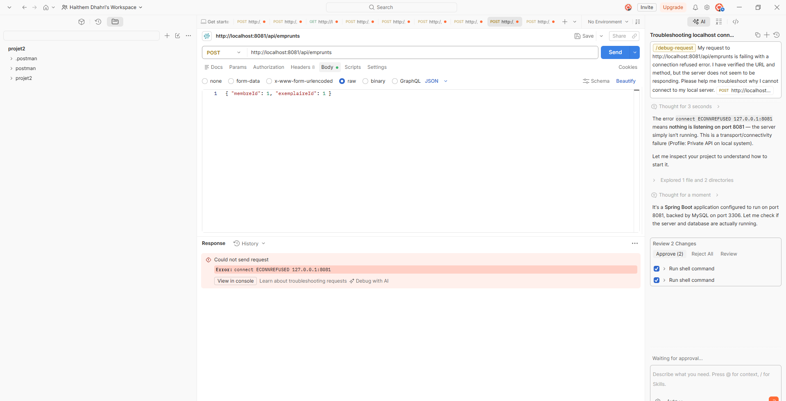
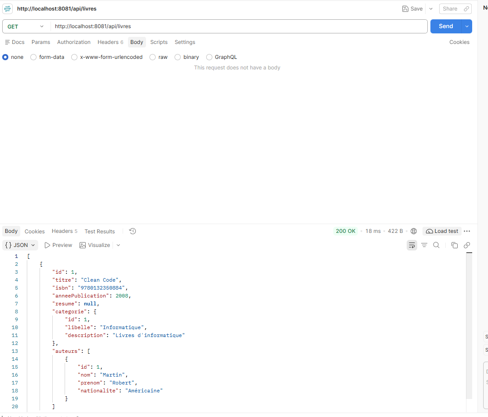
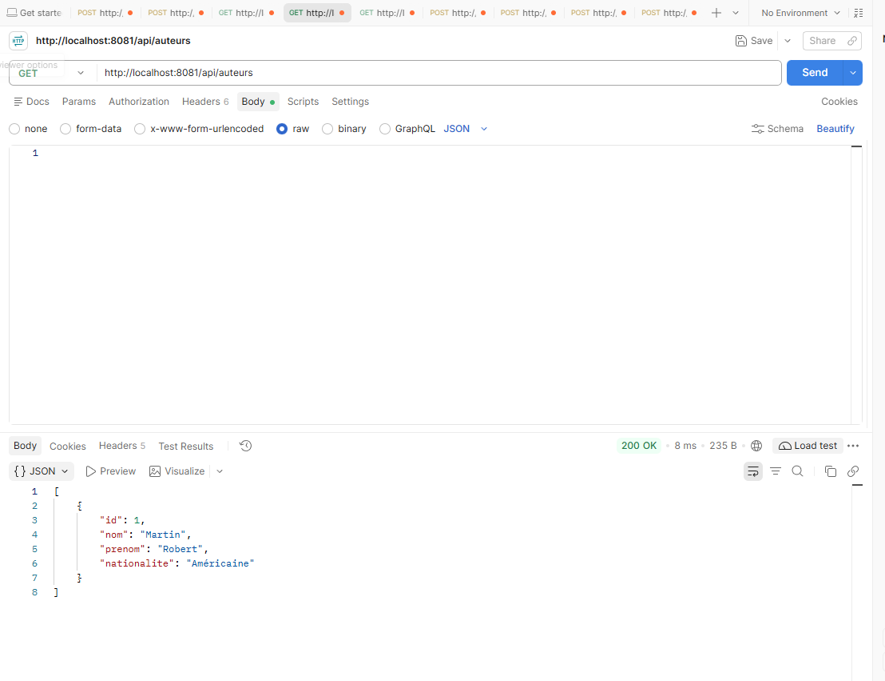
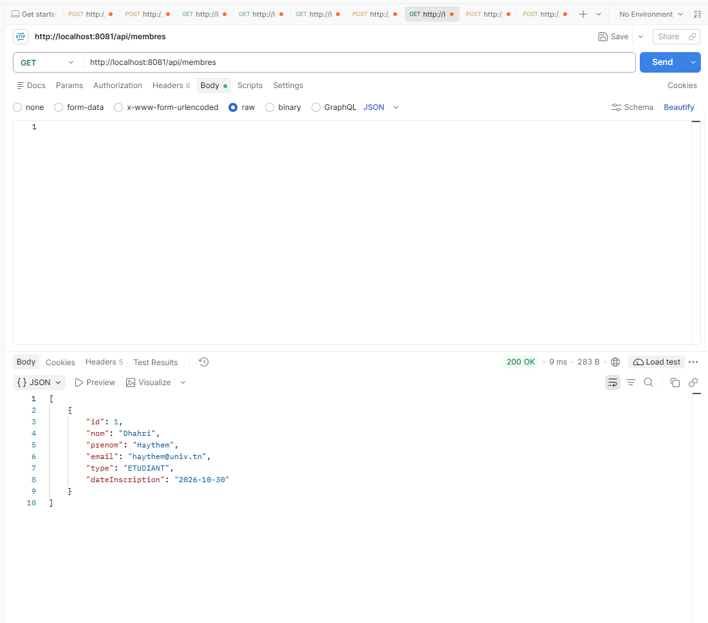
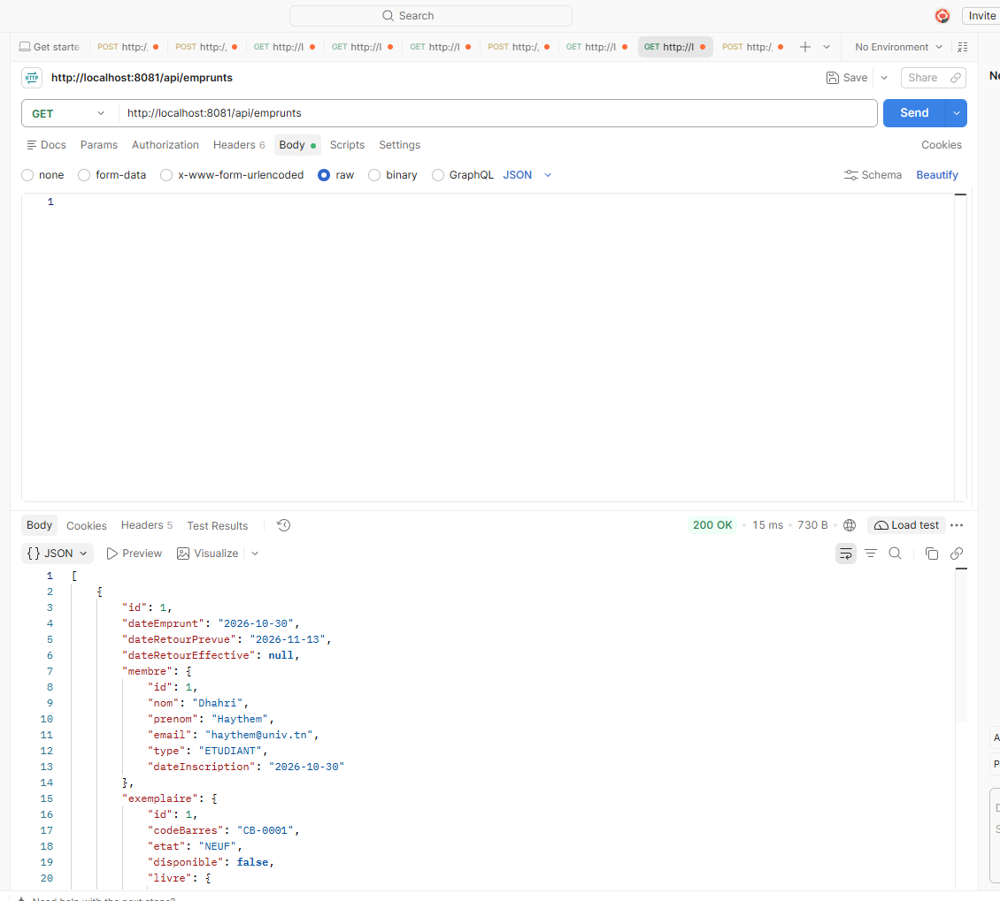
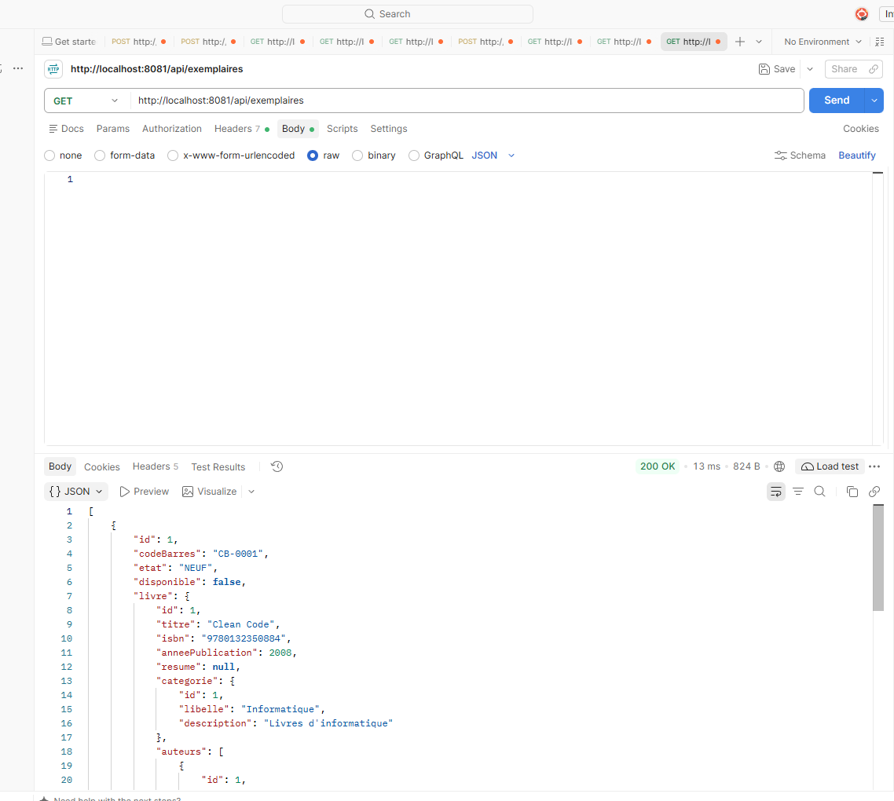

# Bibliothèque universitaire – API REST Spring Boot

Mini-projet (DS1 Développement Web) : gestion d'une bibliothèque universitaire (catalogue, exemplaires, membres, emprunts et réservations).

## Technologies
Java 17 · Spring Boot 3.3 · Spring Data JPA · Bean Validation · MySQL · Postman

## Modèle de données (7 entités)

| Entité | Rôle | Relations |
|---|---|---|
| `Auteur` | Auteur d'un ouvrage | ManyToMany avec `Livre` |
| `Categorie` | Genre / domaine | OneToMany vers `Livre` |
| `Livre` | Titre du catalogue (ISBN unique) | ManyToOne `Categorie`, ManyToMany `Auteur`, OneToMany `Exemplaire` |
| `Exemplaire` | Copie physique d'un livre | ManyToOne `Livre`, OneToMany `Emprunt` |
| `Membre` | Étudiant ou enseignant (email unique) | OneToMany `Emprunt`, OneToMany `Reservation` |
| `Emprunt` | Prêt d'un exemplaire à un membre | ManyToOne `Membre`, ManyToOne `Exemplaire` |
| `Reservation` | Réservation d'un livre par un membre | ManyToOne `Membre`, ManyToOne `Livre` |

## Architecture
`model` → `repository` → `service` → `controller`, plus `exception` (gestion globale des erreurs) et `dto`.
Un `CrudService` et un `CrudController` génériques factorisent le CRUD ; les services métier y ajoutent leurs règles.

## Endpoints

CRUD complet (`GET /`, `GET /{id}`, `POST /`, `PUT /{id}`, `DELETE /{id}`) sur :
`/api/auteurs`, `/api/categories`, `/api/livres`, `/api/exemplaires`, `/api/membres`, `/api/reservations`

Emprunts : `GET /api/emprunts`, `GET /api/emprunts/{id}`, `POST /api/emprunts` (`{"membreId":1,"exemplaireId":1}`), `PUT /api/emprunts/{id}/retour`, `DELETE /api/emprunts/{id}`

Requêtes personnalisées :

| Besoin métier | Endpoint |
|---|---|
| Livres disponibles d'une catégorie | `GET /api/livres/disponibles?categorieId=1` |
| Emprunts en retard | `GET /api/emprunts/en-retard` |
| Top des livres les plus empruntés | `GET /api/emprunts/top-livres?limite=5` |
| Membres avec plus de N emprunts actifs | `GET /api/membres/gros-emprunteurs?seuil=3` |

## Règles métier et gestion des erreurs
- Un exemplaire indisponible ne peut pas être emprunté (409).
- Maximum 5 emprunts actifs par membre (409). Durée de prêt : 14 jours.
- 400 : données invalides (détail par champ) ou JSON mal formé · 404 : ressource introuvable · 409 : conflit métier ou contrainte d'intégrité (doublon ISBN/email, suppression d'une entité référencée).

## Exemples de corps JSON
```json
// POST /api/categories
{ "libelle": "Informatique", "description": "Livres d'informatique" }
// POST /api/auteurs
{ "nom": "Martin", "prenom": "Robert", "nationalite": "Américaine" }
// POST /api/livres
{ "titre": "Clean Code", "isbn": "9780132350884", "anneePublication": 2008,
  "categorie": { "id": 1 }, "auteurs": [ { "id": 1 } ] }
// POST /api/exemplaires
{ "codeBarres": "CB-0001", "etat": "NEUF", "livre": { "id": 1 } }
// POST /api/membres
{ "nom": "Dhahri", "prenom": "Haythem", "email": "Haythem@univ.tn", "type": "ETUDIANT" }
```

## Exécution
1. Démarrer MySQL et adapter `application.properties` (utilisateur / mot de passe). La base `bibliotheque` est créée automatiquement.
2. `mvn spring-boot:run` (API sur http://localhost:8081).
3. `mvn test` pour lancer les tests unitaires.
4. Importer la collection Postman et lancer les requêtes.

## Équipe

- Haythem Dhahri
- Hayfa Gharbi
- Mohamed Skander Ben Hamida

## Tests Postman







